<p align="center">
  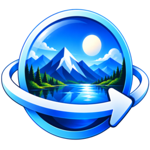
</p>

<h1 align="center">Panoraminal</h1>

<p align="center">
  <b>Paint 360° panoramas from the inside.</b><br>
  A native, GPU-accelerated painter for equirectangular images — written in Rust with wgpu and egui.
</p>

<p align="center">
  <a href="https://github.com/cleitinhodev/panoraminal/releases/latest">Download</a> ·
  <a href="https://www.bugzinho.com/">Website</a> ·
  <a href="https://www.bugzinho.com/donate">Donate</a> ·
  <a href="README.pt-BR.md">Português (Brasil)</a>
</p>

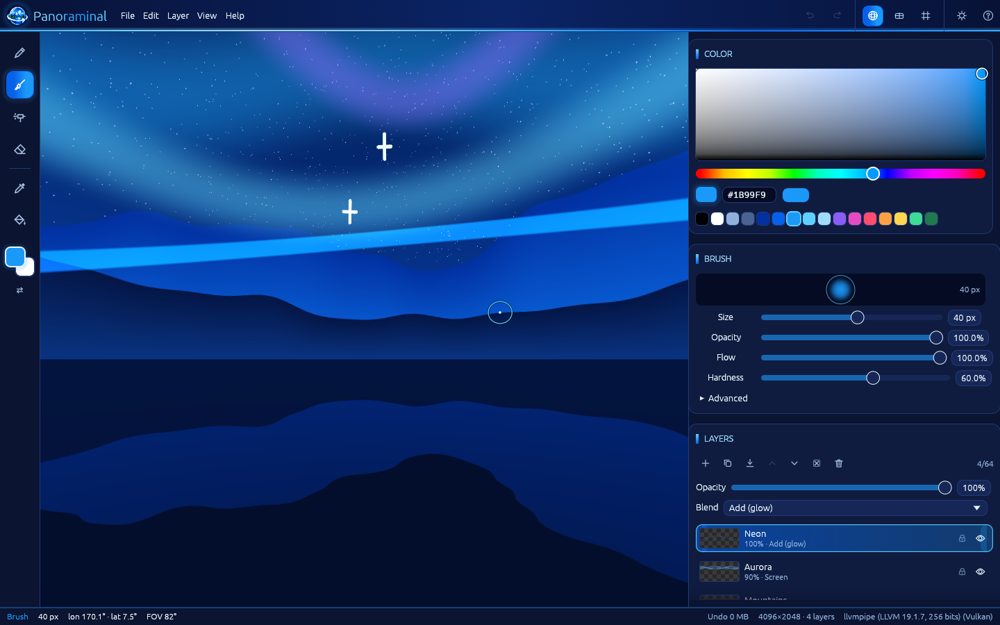

## What is it?

Panoraminal lets you paint **directly on the sphere** of a 360° panorama: you stand in the centre, look around and paint as if the canvas surrounded you. Every stroke is projected back onto the equirectangular image with correct distortion, so lines stay straight on the sphere, the seam is invisible and the poles behave.

When you're done, export a **360° JPEG with GPano metadata** that Facebook, Google Photos and VR viewers recognise, or a plain PNG.

It is the successor of the *Paint360* prototype, rebuilt from scratch as a real desktop app with its own rendering engine.

## Features

- **Two views** — *Sphere* (perspective camera, FOV up to 120°) and *Flat* (equirectangular with wrap-around preview). Toggle with `V`.
- **Brush engine on the sphere** — pen, brush, airbrush and eraser; size, opacity, flow, hardness, spacing, smoothing, polar correction.
- **Custom brushes** (new in 1.1) — a brush library with thumbnails, live preview stroke, rename, categories, favourites and search. Import **Photoshop `.abr`** (v1/v2 and v6+, sampled tips with their presets), **GIMP `.gbr` / `.gih`** and any **PNG / JPEG / WebP** as a tip. Dynamics: spacing, angle, roundness, size/angle/roundness jitter, scatter, count, opacity/flow jitter, random flips and pen pressure. Stamps are projected on the sphere, so they look right across the seam and at the poles. Brushes used in a project are embedded in the `.pano` file.
- **Place images in the scene** (new in 1.1) — drop, paste or insert a photo/logo and it floats over the panorama as a non-destructive object: move, scale (uniform or free), rotate, flip and fade it with on-canvas handles in both views. Two projections: **Wrap** (bent onto the sphere like a sticker) and **Persistent** (a flat picture projected from the centre, undistorted from its anchor direction, with *Re-aim to view*). Live GPU preview, full-quality bake on `Enter`, *Place as new layer*, `Esc` to cancel, undo/redo.
- **Distort / perspective** (new in 1.2) — press `D` while placing an image and drag its **four corner pins** onto the corners of a wall, a screen or a floor: the image is mapped with a true perspective (homography), so it looks like part of the scene. In **Persistent** projection straight lines stay straight on the sphere; `W` adds a **4×4 mesh warp** for curved surfaces. `Shift` locks an axis, edge handles move two pins at once, pin coordinates can be typed in, *Reset distortion* starts over, and folded or collapsed shapes are refused with a warning. Distortion is part of the placement's undo and survives moving, scaling, rotating and switching projection.
- **Pen pressure** for size and/or opacity (see [limitations](#known-limitations)).
- **Straight lines** with `Shift`+click (great circles), **eyedropper** (`I` or `Alt`+click), **360°-aware flood fill** that wraps across the seam.
- **Layers** — up to 64, with drag & drop reordering, rename, visibility, alpha lock, opacity and 9 blend modes (normal, multiply, screen, overlay, darken, lighten, add/glow, difference, soft light), live thumbnails.
- **Undo / redo** with a configurable memory budget.
- **`.pano` projects** (ZIP with PNG layers + JSON manifest + preview). Old Paint360 `.p360.json` projects are imported.
- **Import** PNG, JPEG, WebP, BMP and TIFF as a new document or as a layer; drag & drop files onto the window.
- **Export** PNG or 360° JPEG (GPano XMP), rotate heading, flip horizontally.
- **Autosave and crash recovery**, unsaved-changes prompt.
- **Themes** — dark, light or follow the system, with a palette taken from the icon. Gradients, neon glow and animations can be reduced or **turned off** (Settings → Appearance); the system "reduce motion" preference is honoured.
- **Help** (all shortcuts, tools and 360° tips) and **About** windows.
- **8 languages** — Português (Brasil), English, Español, Français, Deutsch, Italiano, 日本語, 简体中文. Auto-detected and switchable at runtime; CJK glyphs are bundled.
- Native file dialogs, `.pano` file association (Windows installer, Linux `.desktop`/MIME).

| | |
|---|---|
| 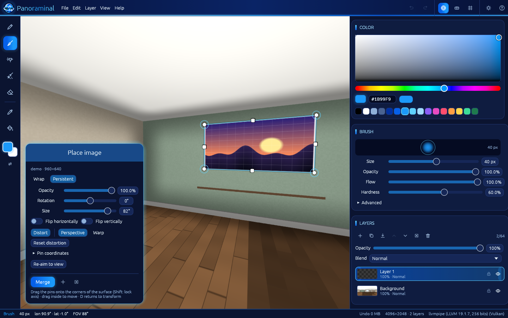 | 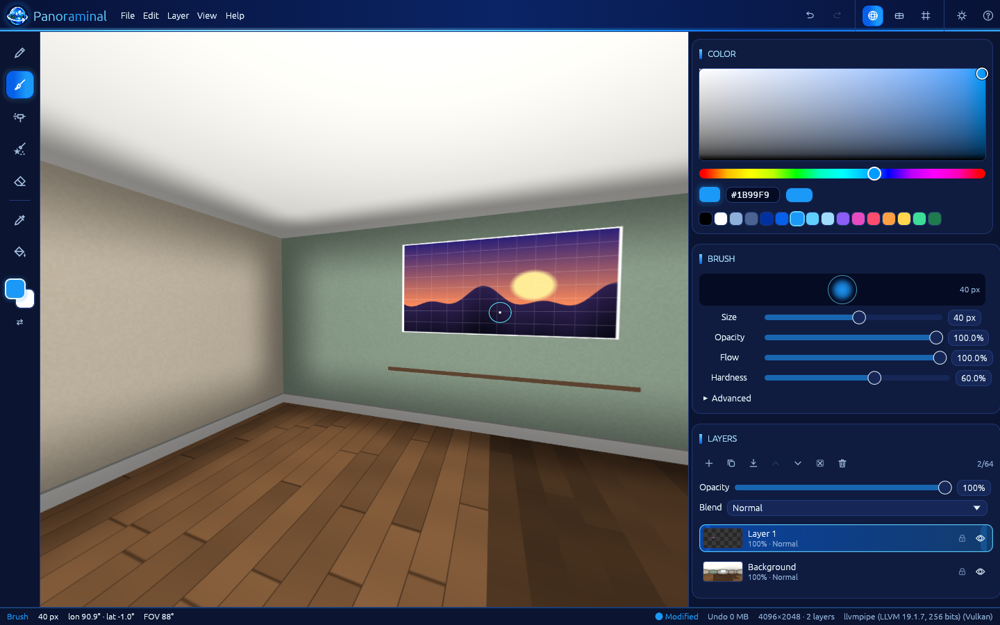 |
| 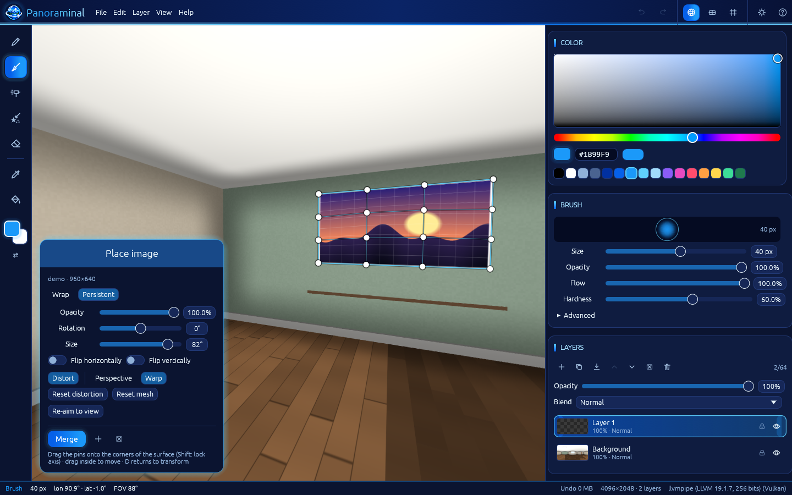 | 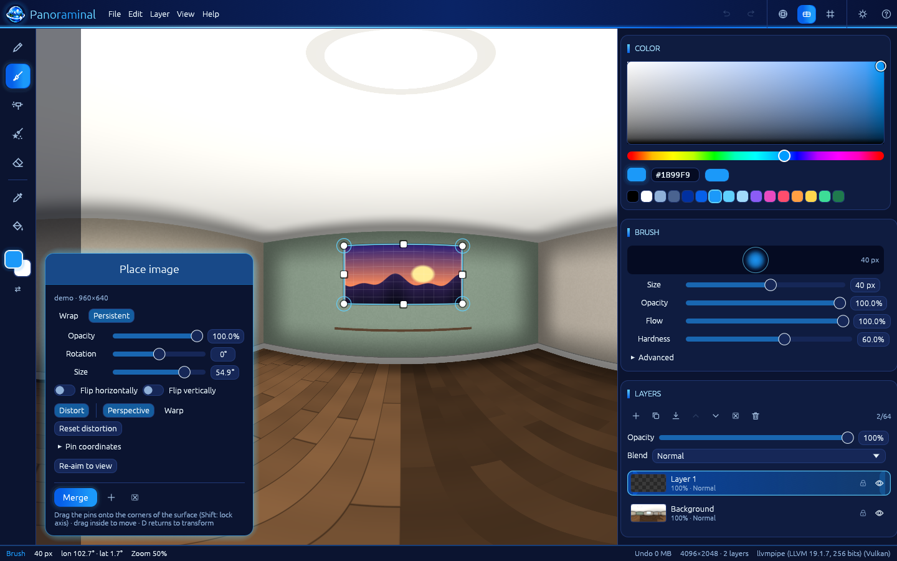 |
| 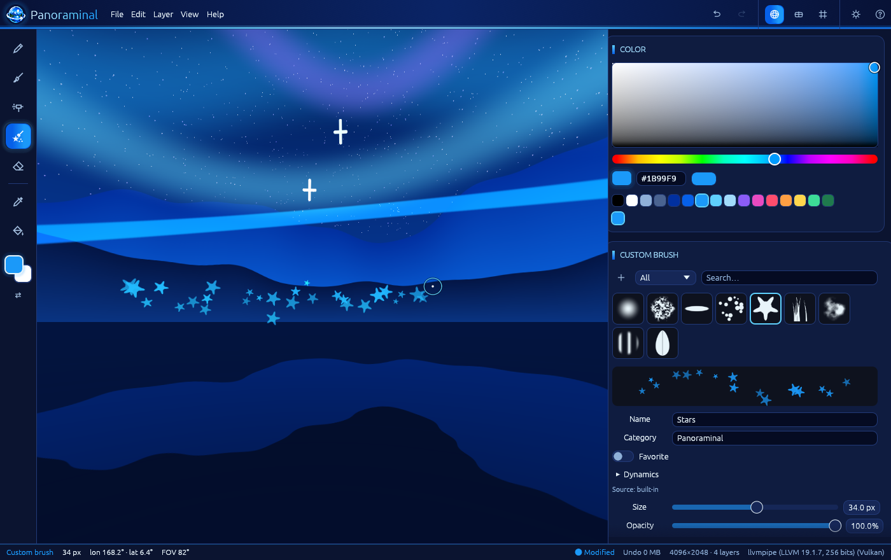 | 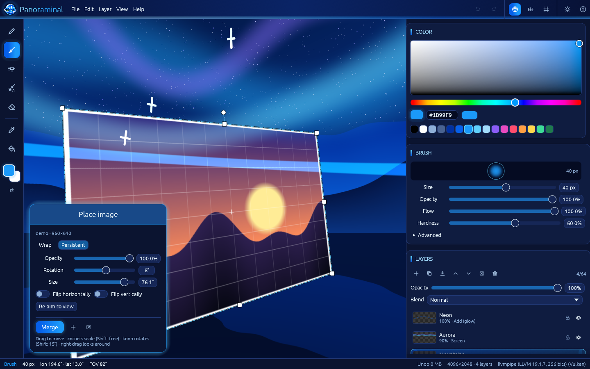 |
| 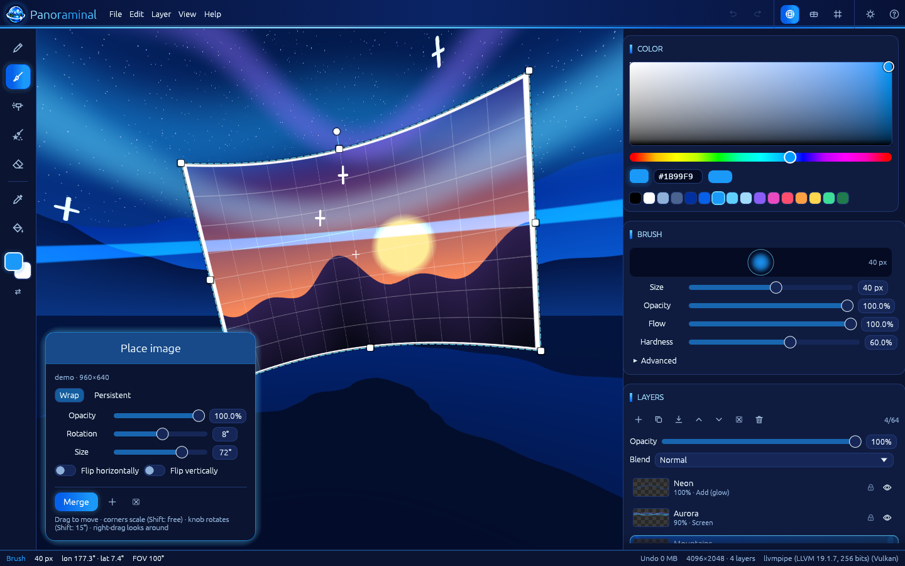 | 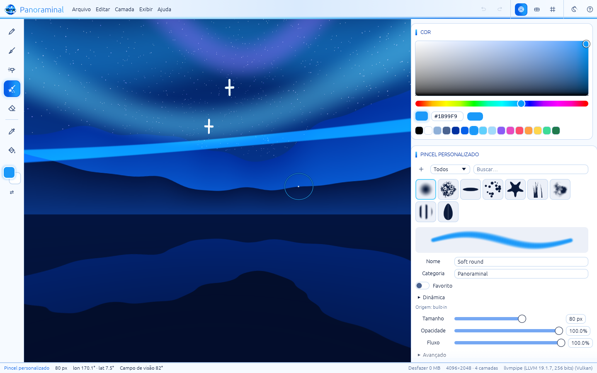 |
| 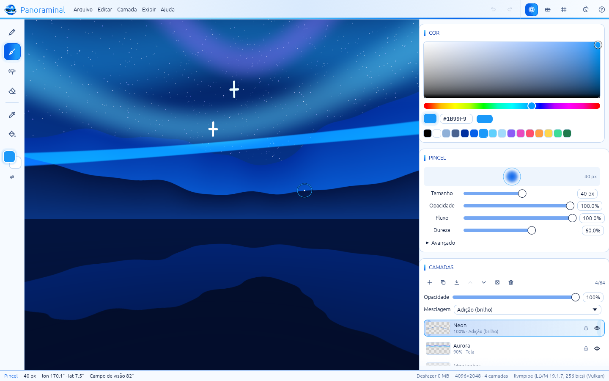 | 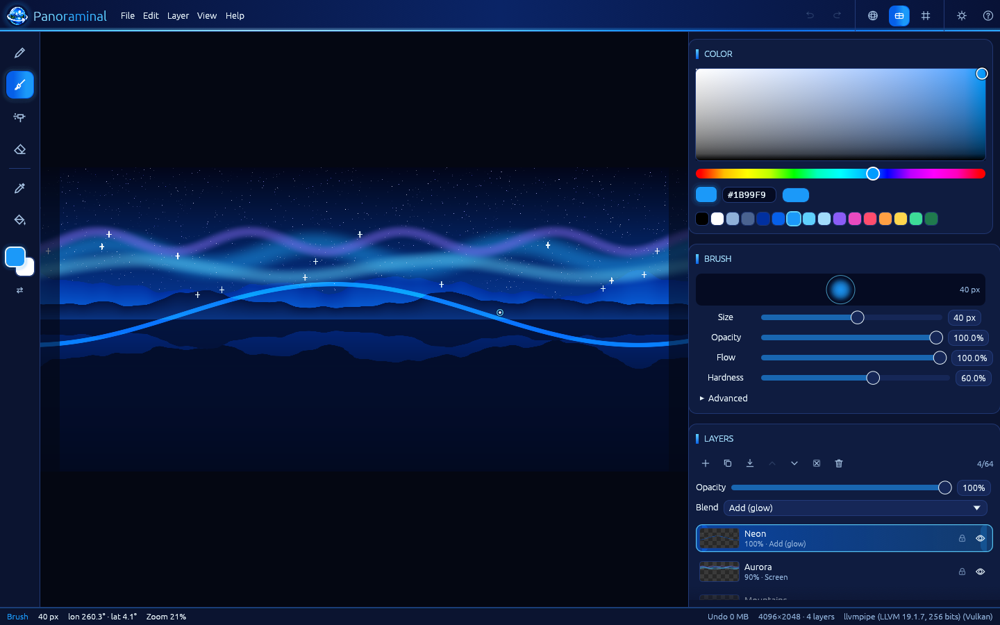 |
| 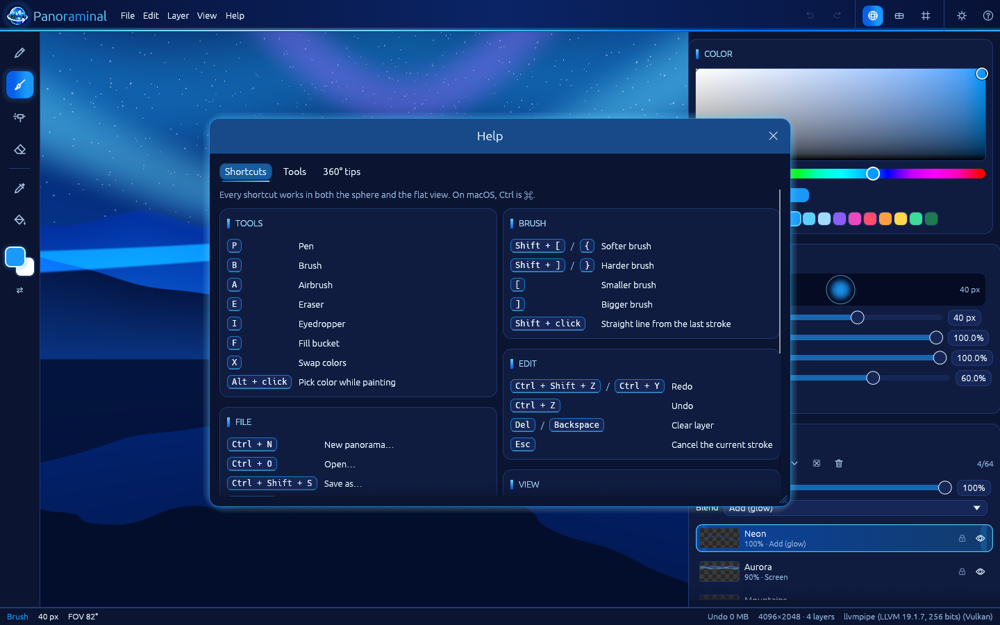 | 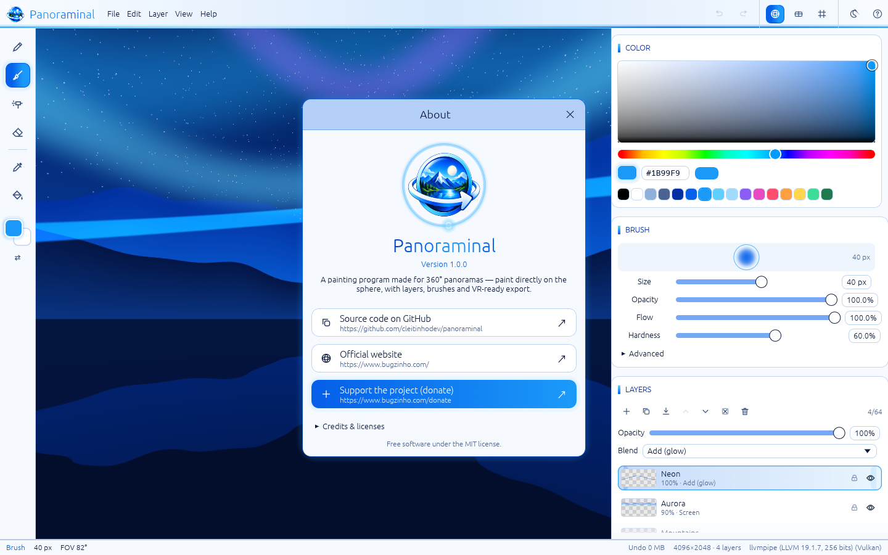 |
| 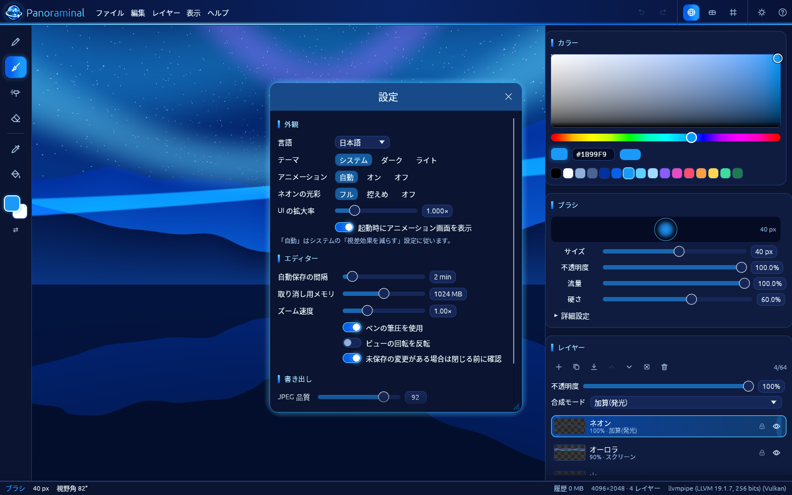 | |

## Download

Grab the latest build from the [Releases page](https://github.com/cleitinhodev/panoraminal/releases/latest):

| Platform | File |
|---|---|
| Windows 10/11 x64 | `Panoraminal-Setup-<version>-x64.exe` (installer) or `Panoraminal-<version>-windows-x64-portable.zip` |
| Linux x86_64 | `Panoraminal-<version>-x86_64.AppImage`, `panoraminal_<version>_amd64.deb` or `panoraminal-<version>-linux-x86_64.tar.gz` |
| macOS (universal) | `Panoraminal-<version>-macos-universal.zip` (unsigned — right-click → Open the first time) |

A GPU with Vulkan, Metal, DirectX 12 or OpenGL 3.3+ is recommended. Panoraminal also runs on software renderers (slowly).

## Keyboard shortcuts

`Ctrl` becomes `⌘` on macOS. The full list is in **Help → Shortcuts** (`F1`).

| Tools | | Brush | |
|---|---|---|---|
| `P` Pen | `B` Brush | `[` / `]` Size − / + | `{` / `}` Hardness − / + |
| `A` Airbrush · `C` Custom brush | `E` Eraser | `Shift`+click Line from last point | `Alt`+click Pick colour |
| `I` Eyedropper | `F` Fill | `X` Swap colours | `Esc` Cancel stroke / close window |

| File | | Edit & layers | |
|---|---|---|---|
| `Ctrl+N` New | `Ctrl+O` Open | `Ctrl+Z` Undo | `Ctrl+Shift+Z` / `Ctrl+Y` Redo |
| `Ctrl+S` Save | `Ctrl+Shift+S` Save as | `Del` Clear layer | `Ctrl+Shift+N` New layer |
| `Ctrl+E` Export PNG | `Ctrl+Shift+E` Export 360° JPEG | `Ctrl+J` Duplicate layer | `Ctrl+M` Merge down |
| `Ctrl+I` Import as layer | `Ctrl+,` Settings | `Ctrl+Shift+V` / `Ctrl+V` Paste image | `Enter` Merge placed image |
| `Ctrl+Shift+I` Insert image | `Ctrl+Shift+B` Import brushes | `Esc` Cancel placement | `D` Distort placed image · `W` Mesh warp |

| View | |
|---|---|
| `V` Sphere / flat | `G` Grid |
| Right/middle-drag or `Space`+drag — look around / pan | Wheel, `+` / `-` — zoom (FOV) |
| Arrow keys — rotate the view | `0` Reset view |
| `Tab` Hide interface | `F11` Fullscreen |

## Building from source

Requirements: a recent stable Rust (1.95 or newer). On Linux you also need the GTK 3 and xkbcommon development packages for native dialogs and the window:

```sh
sudo apt install libgtk-3-dev libxkbcommon-dev   # Debian / Ubuntu
cargo run --release -p panoraminal
```

Run the tests and lints:

```sh
cargo test --workspace
cargo clippy --workspace --all-targets -- -D warnings
cargo fmt --all --check
```

Packaging scripts live in [`packaging/`](packaging): `packaging/linux/build-packages.sh` builds the AppImage, `.deb` and tarball; `packaging/windows/panoraminal.nsi` is the NSIS installer. Tagged pushes (`v*`) build every platform on GitHub Actions — see [`.github/workflows/release.yml`](.github/workflows/release.yml).

### Project layout

| Crate | Role |
|---|---|
| `panoraminal-core` | Document model, layers, blend modes, sphere ↔ equirectangular math, brush engine, fill, undo history (no GPU, fully unit-tested) |
| `panoraminal-render` | wgpu renderer: layer compositing and sphere / flat projection shaders |
| `panoraminal-io` | `.pano` format, legacy import, image import/export, GPano XMP |
| `panoraminal-i18n` | Locale loading, fallback and placeholder formatting |
| `panoraminal` | The application: egui UI, themes, tools, settings, help/about, CLI |

### Command line

```
panoraminal [FILE]                 open a .pano project or an image
  --lang <code>                    force a language (en, pt-BR, es, fr, de, it, ja, zh-CN)
  --theme <dark|light|system>      force a theme
  --tool <pen|brush|airbrush|custom|eraser>   start with a tool
  --place-demo <wrap|gnomonic|wall|wall-warp|wall-merged>
                                   float a demo picture (wall* = pinned onto a
                                   synthetic room, used for the screenshots)
  --version, --help
```

## Known limitations

- **Pen pressure** comes from the OS through winit. It works with Windows Ink / pointer-pen devices and touch-force devices; Wintab-only tablet drivers and many X11/Wayland tablets don't report pressure to winit yet — strokes then use full pressure.
- **ABR import** reads sampled and computed tips and the common presets (see Features). Dual brush, texture, bristle/erodible tips, colour dynamics, wet edges and noise have no equivalent yet: they are skipped and listed in a notice on the brush. Colour tips are used as masks (painted with the current colour). The importer is tested with synthesized files; please open an issue with any `.abr` that doesn't load.
- **Distortion in Wrap projection** applies the homography in the patch's angular (tangent) coordinates, so it is only approximately perspective-correct for large patches; use **Persistent** for walls and other flat surfaces. The mesh warp is a fixed 4×4 grid (bilinear cells); the live preview of a distorted image uses at most 2048 px (the merge uses the full image).
- Placed images are limited to 4096 px on the longest side (larger images are downscaled).
- Maximum document size is 8192 × 4096 (the GPU texture limit of most cards); 64 layers.
- The macOS build is produced by CI and is not code-signed or notarised.
- With a software renderer (llvmpipe, WARP) large documents are slow.
- At startup Panoraminal checks that the graphics backend can create a device and falls back (DirectX 12 → Vulkan → OpenGL on Windows, Vulkan → OpenGL on Linux). To force one, set `WGPU_BACKEND=vulkan`, `dx12`, `gl` or `metal`.

## Translations

Locale files are plain JSON in [`crates/panoraminal-i18n/locales`](crates/panoraminal-i18n/locales). A test verifies that every language has every key and the same `{placeholders}`. See [CONTRIBUTING.md](CONTRIBUTING.md).

## Support the project

Panoraminal is free and open source. If it's useful to you, consider [donating](https://www.bugzinho.com/donate) — and visit [bugzinho.com](https://www.bugzinho.com/).

## License

[MIT](LICENSE) © 2026 cleitinhodev / bugzinho. The bundled Noto Sans CJK subset is licensed under the [SIL Open Font License 1.1](crates/panoraminal/assets/fonts/OFL.txt).
